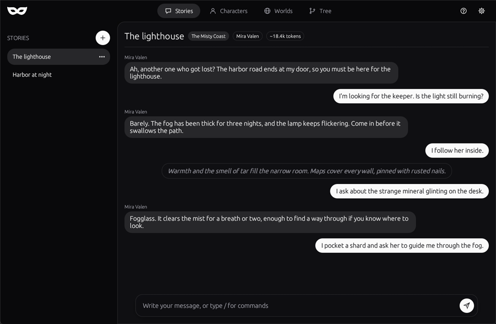
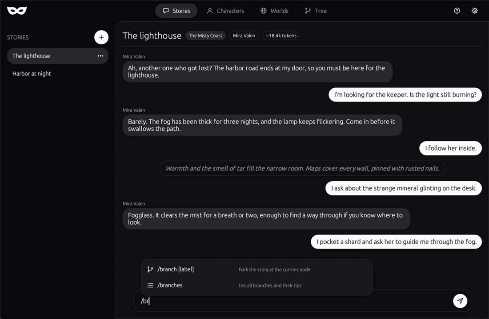
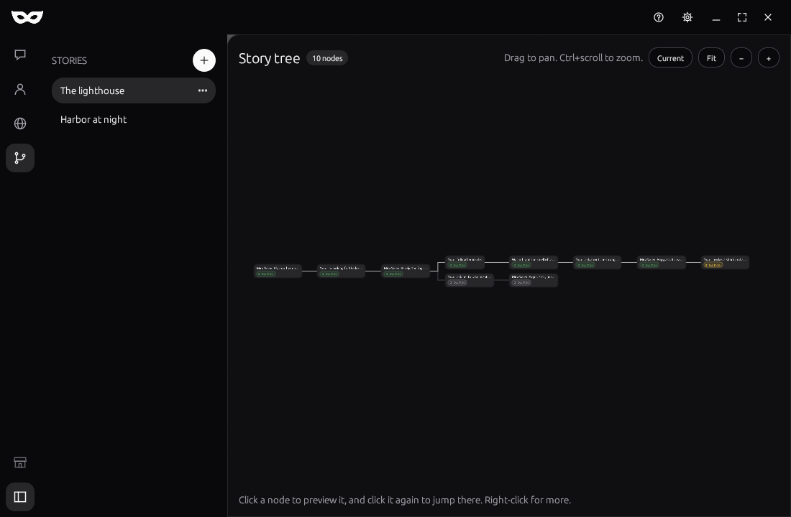
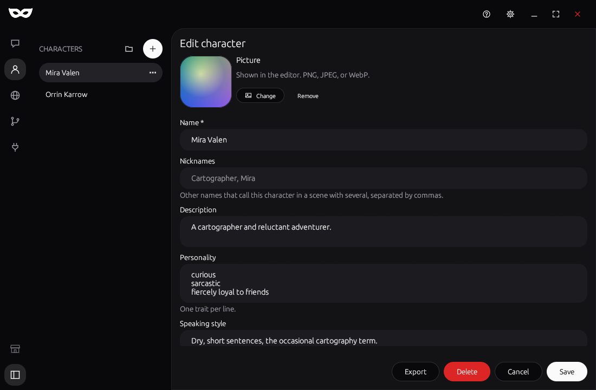
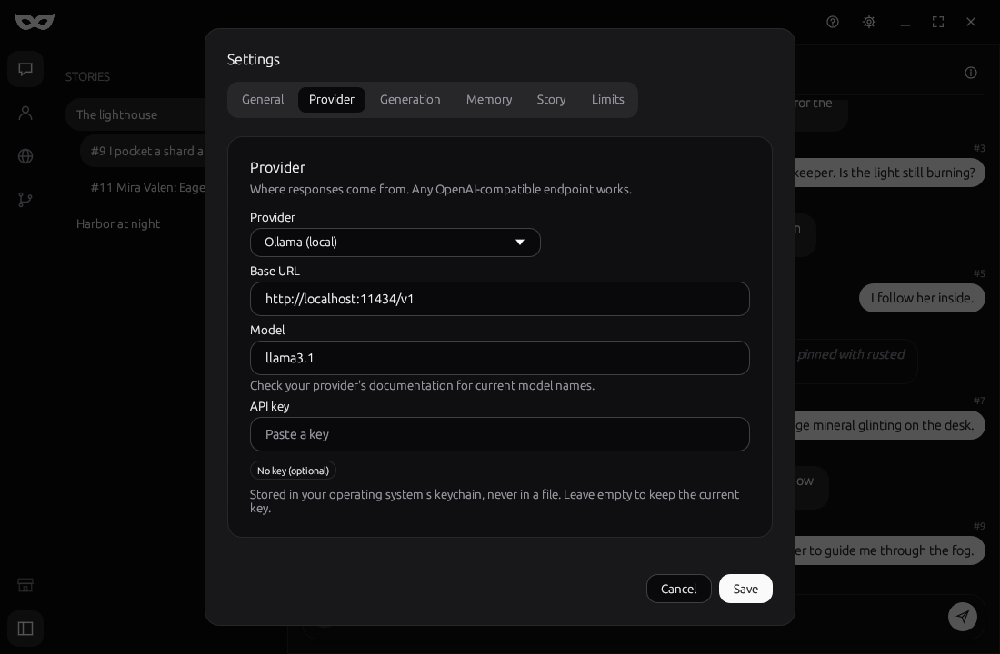
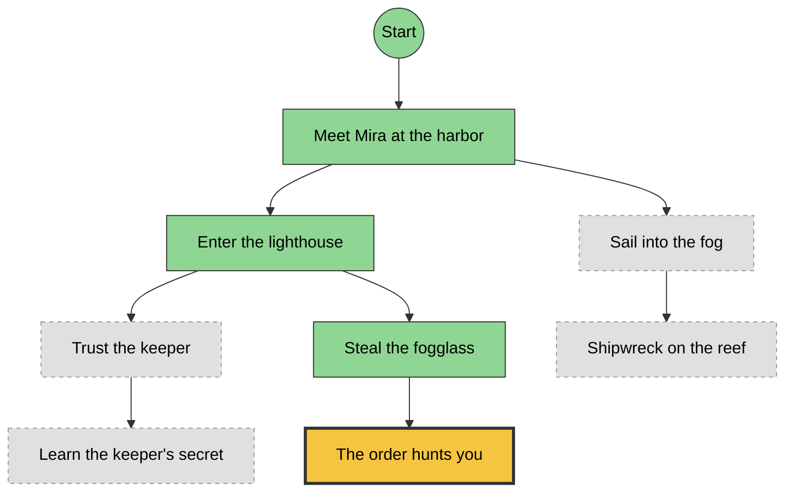

<p align="center">
  
</p>

<h1 align="center">MasqueRole</h1>

<p align="center">
  <strong>A native desktop app for endless, consistent, and persistent AI roleplay.<br>
  Bring your own model. Written in Rust.</strong>
</p>

<p align="center">
  <a href="https://github.com/MasqueRole/MasqueRole/actions/workflows/ci.yml"></a>
  <a href="https://github.com/MasqueRole/MasqueRole/releases/latest"></a>
  <a href="https://github.com/MasqueRole/MasqueRole/releases"></a>
  <a href="LICENSE"></a>
</p>

<p align="center">
  
  
  
  <a href="https://github.com/MasqueRole/MasqueRole/commits/main"></a>
  <a href="https://github.com/MasqueRole/MasqueRole/issues"></a>
  <a href="https://github.com/MasqueRole/MasqueRole/pulls"></a>
</p>

<p align="center">
  <a href="https://github.com/MasqueRole/MasqueRole/releases/latest">Download</a> ·
  <a href="#quick-start">Quick Start</a> ·
  <a href="#features">Features</a> ·
  <a href="https://github.com/MasqueRole/MasqueRole/issues">Report a bug</a>
</p>

<p align="center">
  
</p>

MasqueRole sits between you and the language model provider you choose (xAI, OpenAI, Anthropic, OpenRouter, or a local model via Ollama or LM Studio). It handles character cards, world knowledge, long-term memory, and a branching story tree, so stories don't fall apart when they hit context limits or the model forgets what happened.

---

## Table of Contents

- [Features](#features)
- [Screenshots](#screenshots)
- [Tech Stack](#tech-stack)
- [Requirements](#requirements)
- [Installation](#installation)
- [Quick Start](#quick-start)
- [Configuration](#configuration)
- [Character Cards](#character-cards)
- [Worlds & Scenarios](#worlds--scenarios)
- [Memory System](#memory-system)
- [Story Tree](#story-tree)
- [Commands](#commands)
- [Project Structure](#project-structure)
- [Roadmap](#roadmap)
- [Contributing](#contributing)
- [Usage Notes](#usage-notes)
- [License](#license)

---

## Features

- **Native desktop app:** Windows and Linux. Ships as a single small binary with fast startup. No browser, no web runtime, no server to run.
- **Endless sessions:** Automatic summarization of older messages keeps the context lean without losing the plot.
- **Story Tree:** Branch your story into parallel storylines, visualized as a skill tree. Jump back to any node and continue from there.
- **Character cards:** Personality, speaking style, background, and example dialogue per character in a simple file.
- **World knowledge (lorebook):** Entries are injected only when matching keywords appear in the conversation.
- **Layered memory:** Short-term, summary, and fact memory.
- **Local-first:** Sessions are stored in a local SQLite database. Your API key lives in the operating system's secure storage.
- **Streaming:** Responses appear token by token.
- **Multiple characters:** Group scenes with several characters and a narrator mode.
- **Uniform design system:** Every screen is built from a shared component library (`ir-ui`), a shadcn-style set of themed components for egui, with light and dark themes.
- **Customizable prompts:** System prompt templates and style profiles (e.g. fantasy, noir, slice of life).

## Screenshots

<table>
  <tr>
    <td width="50%"><br><sub><b>Stories</b>: write, and type <code>/</code> for commands.</sub></td>
    <td width="50%"><br><sub><b>Story tree</b>: every path you explored, and where you are.</sub></td>
  </tr>
  <tr>
    <td width="50%"><br><sub><b>Characters</b> and <b>Worlds</b>, each with its own editor.</sub></td>
    <td width="50%"><br><sub><b>Settings</b>: any OpenAI-compatible provider, or a local model.</sub></td>
  </tr>
</table>

## Tech Stack

The goal is a **lightweight native desktop app in pure Rust** with as little complexity as possible: one language, one toolchain, one binary.

| Layer            | Choice                                                    | Why                                                                 |
|------------------|-----------------------------------------------------------|---------------------------------------------------------------------|
| Language         | Rust                                                      | Fast, memory-safe, and everything (UI and logic) in one language.   |
| GUI              | [egui](https://github.com/emilk/egui) / `eframe`          | Simple immediate-mode UI with no web stack. Custom drawing makes the skill-tree view easy. |
| Async runtime    | `tokio`                                                   | Runs API calls and streaming in the background without freezing the UI. |
| HTTP / streaming | `reqwest`                                                 | Calls the provider's API and reads streamed (SSE) responses.               |
| Storage          | SQLite via `rusqlite` (bundled)                           | One local file, reliable, trivial to back up.                       |
| Serialization    | `serde` with JSON/TOML/YAML                               | Settings, character cards, and lorebooks.                           |
| Secrets          | `keyring`                                                 | Stores the API key in the OS keychain, never in plain text.         |
| Errors & logging | `anyhow`, `thiserror`, `tracing`                          | Clear errors and optional debug logs.                               |

The code is split into a UI-independent **core library** and a thin **GUI app**. That keeps the logic easy to test and leaves the door open for other front ends (such as a CLI) later.

**Why not the alternatives?**

- **Tauri / Electron:** Both need a web frontend and a JavaScript toolchain on top of Rust. That is more moving parts than this project needs.
- **Iced / Slint:** Good Rust GUI toolkits, but egui is the quickest to get started with and the easiest for custom-drawn views like the story tree.
- **Python + Qt:** Good on desktop, but packaging and distribution are painful.

## Requirements

**To use the app:** An API key for any supported provider and an internet connection, or a locally running model (e.g. Ollama or LM Studio) that needs no key and no internet.

> **Paid providers can get expensive.** Hosted providers bill every request, and a long story sends a lot of text with each message. The app shows a warning when you pick one. Neither MasqueRole nor its creators are liable for API costs, including unexpectedly high ones. Set a token limit (see `[limits]` below) and watch your provider's usage page.

**To build from source:**

- [Rust](https://rustup.rs) (stable toolchain, edition 2021 or newer)
- On Linux: a few system libraries for windowing and keychain access (see the [eframe documentation](https://github.com/emilk/egui/tree/master/crates/eframe) for the exact packages for your distribution)

## Installation

### Download

Installers for Windows (`.exe`) and Linux (`.deb`, `.AppImage`) are built by the release workflow and attached to each version on the [Releases](https://github.com/MasqueRole/MasqueRole/releases) page.

### Build from source

```bash
git clone https://github.com/MasqueRole/MasqueRole.git
cd MasqueRole

cargo run -p ir-app               # run in development mode
cargo build --release -p ir-app   # optimized binary in target/release/
```

To build the installers yourself, install [`cargo-packager`](https://github.com/crabnebula-dev/cargo-packager) and run it after a release build (settings are in `Packager.toml`):

```bash
cargo install cargo-packager --locked
cargo packager --release --formats nsis          # Windows
cargo packager --release --formats deb,appimage  # Linux
```

## Quick Start

1. Launch MasqueRole. A short **tutorial** with screenshots opens the first time; reopen it any time with the question mark button next to Settings.
2. Click **Settings** (top right) and choose a **provider** and paste your API key (not needed for local models).
3. Open **Characters** (and, optionally, **Worlds**) with the icons in the rail at the left to create or edit them. Each section has its own list next to the rail, which the sidebar button at the bottom of the rail hides.
4. Go to **Stories**, press the **+** button, and start writing. Press **Enter** to send and **Shift+Enter** for a new line. Type **/** to see the commands, and click one to use it. **Tree** shows the branches of the open story. Click a message to branch from it or copy it, and click the story title for its world and characters.

For development, you can also provide the key through the `IR_API_KEY` environment variable. Set `IR_DATA_DIR` to keep settings, sessions, and the library in another folder (a portable install or a clean test profile).

## Configuration

Most options are available in the **Settings** overlay (the gear at the top right), which has tabs for General, Provider, Generation, Memory, Story, and Limits. They are stored in `settings.toml` in the app's data directory:

```toml
[api]
provider = "openai-compatible"   # or a built-in preset, e.g. "xai", "openai", "anthropic", "ollama"
base_url = "https://api.example.com/v1" # endpoint of your provider
model = "your-model-name"         # check your provider's docs for current model names
temperature = 0.9
max_tokens = 800
stream = true

[context]
max_context_tokens = 24000
recent_messages = 20
summarize_after = 30

[memory]
enabled = true
fact_extraction = true

[style]
profile = "default"
narrator_mode = false

[tree]
auto_checkpoint = true
node_label = "auto"       # "auto" = short AI-generated label, "manual" = ask
show_tree_on_branch = true

[limits]
token_limit_enabled = false   # stop a story once it has used about token_limit tokens
token_limit = 200000          # estimated tokens per story (an estimate, not your provider's bill)

[debug]
logging = false           # write masquerole.log next to settings.toml (after a restart)
```

| Setting                    | Description                                                    |
|----------------------------|----------------------------------------------------------------|
| `api.provider`             | Provider preset or `openai-compatible` for any compatible endpoint |
| `api.base_url`             | API endpoint (e.g. a local server at `http://localhost:11434/v1`) |
| `context.max_context_tokens` | Upper limit for the context sent to the API                  |
| `context.recent_messages`  | Number of messages kept verbatim                               |
| `context.summarize_after`  | Older messages are condensed beyond this point                 |
| `memory.fact_extraction`   | Automatically remember important facts                         |
| `tree.auto_checkpoint`     | Create a story-tree node after every turn                      |
| `tree.node_label`          | `auto` = short AI-generated label, `manual` = ask every time   |
| `debug.logging`            | Write a debug log for bug reports. API keys are removed from it |
| `ui.reduce_motion`         | Turn off movement and scaling in the interface (fades stay)     |
| `limits.token_limit_enabled` | Stop a story from generating once it reaches the limit        |
| `limits.token_limit`       | Estimated tokens one story may use (prompts, responses, summaries) |

> ⚠️ The API key is stored in your operating system's keychain, never in `settings.toml`. Don't commit keys to version control.

## Character Cards

Characters are YAML files that you can create in the app or import from disk:

```yaml
name: "Mira Valen"
description: "A cartographer and reluctant adventurer."
personality:
  - curious
  - sarcastic
  - fiercely loyal to friends
speaking_style: "Dry, short sentences, the occasional cartography term."
background: |
  Mira grew up in the harbor towns of the north and has
  been mapping uncharted coastlines for ten years.
greeting: "Ah, another one who got lost?"
example_dialogue:
  - user: "Where to next?"
    character: "Wherever the map runs out. That's where it gets interesting."
image: "1a2b3c.png"   # optional; set with "Add picture" in the editor
```

Pictures (PNG, JPEG, or WebP) are shrunk to at most 512 pixels, stored as PNG in the library's `images` folder, and removed again when the character is deleted. In a story, a character's picture shows beside its messages. A world's picture shows next to the story title and as the backdrop of the story's info page, fading into the background.

## Worlds & Scenarios

A lorebook provides background knowledge that is only added to the prompt when needed:

```yaml
name: "The Misty Coast"
setting: "A coastal region where constant fog makes navigation nearly impossible."
entries:
  - keys: ["lighthouse", "keeper"]
    content: "The Karrow lighthouse has been guarded by an order for centuries."
  - keys: ["fogglass"]
    content: "Fogglass is a rare mineral that briefly clears fog."
image: "4d5e6f.png"   # optional, like for characters
```

## Memory System

MasqueRole uses three layers:

1. **Short-term memory:** the most recent messages, verbatim.
2. **Summary:** a condensed version of older events, continuously updated.
3. **Fact store:** persistent facts (names, relationships, places, items) that are re-injected when relevant.

This way, even after hundreds of messages, the story remembers who promised what to whom.

## Story Tree

Every story is stored as a **tree of nodes** instead of a single linear chat log. Each node is a point in the story (a turn or a key moment). Whenever you want to try a different path, you branch off from any node. The result looks and works like a skill tree: you see every path you have explored, which one you are on right now, and the roads not taken.



*The tree grows from left to right, with a curved line from every node to its replies. The line of the path you took is blue. Every node is a card with a date pill: gold for the current position, green for the path you took, and gray for alternative branches. Hover a card to see its whole title. Drag a card to move it: every story remembers where you put its cards, and the Tidy button puts them all back.*

In the app, the tree is an interactive view drawn with egui: click a node and it opens into a larger card with the whole message and the buttons to jump there or collapse its branch. Scroll and drag to navigate large trees, and press Escape to close the card. The `/tree` command prints a text version:

```
● Start
└─● Meet Mira at the harbor                     [#2]
  ├─● Enter the lighthouse                      [#5]
  │ ├─○ Trust the keeper                        [#9]
  │ │ └─○ Learn the keeper's secret             [#14]
  │ └─● Steal the fogglass                      [#8]
  │   └─◆ The order hunts you   ← you are here  [#12]
  └─○ Sail into the fog                         [#4]
    └─○ Shipwreck on the reef                   [#7]

● on current path   ◆ current node   ○ other branch
```

### How it works

- **Nodes:** Each node stores the message, the memory state (summary and facts), and the active lorebook entries at that moment. Jumping back restores exactly that state.
- **Branching:** Branching marks the current node as a fork point. Whatever you write next starts a new storyline. The old one stays untouched.
- **Going back:** Jump to any earlier node. Facts learned *after* that node are not remembered on the new path, so there are no spoilers from the other timeline.
- **Labels & bookmarks:** Nodes get short auto-generated labels. Bookmark important decision points and return to them by name.
- **Switching branches:** You can jump between branches at any time. Nothing is deleted unless you explicitly prune it.
- **Storage:** Nodes are stored in the session's SQLite database, with each node pointing to its parent. Where you moved a node's card in the tree view is stored there too.

## Commands

Everything is also available through buttons and menus in the UI. In the chat input, these slash commands work as shortcuts:

| Command                | Function                                 |
|------------------------|------------------------------------------|
| `/save [name]`         | Save the session                         |
| `/load <name>`         | Load a session                           |
| `/retry`               | Regenerate the last response             |
| `/undo`                | Step back to the parent node             |
| `/tree`                | Show the story tree                      |
| `/branch [label]`      | Fork the story at the current node       |
| `/goto <node\|label>`  | Jump to any node or bookmark             |
| `/mark <label>`        | Bookmark the current node                |
| `/branches`            | List all branches and their tips         |
| `/prune <node>`        | Delete a node and its subtree            |
| `/memory`              | Show stored facts                        |
| `/forget <id>`         | Remove a fact                            |
| `/summary`             | Show the current summary                 |
| `/compact`             | Summarize all but the last two messages  |
| `/char <name>`         | Switch or add a character                |
| `/style <profile>`     | Switch style profile                     |
| `/narrator on\|off`    | Toggle narrator mode                     |

## Project Structure

A Cargo workspace with a UI-independent core library, a UI component library, and the desktop app:

```
MasqueRole/
├── Cargo.toml                  # Workspace manifest
├── crates/
│   ├── ir-core/                # Core logic, no UI code
│   │   └── src/
│   │       ├── lib.rs
│   │       ├── client.rs       # Provider-agnostic LLM client (streaming)
│   │       ├── context.rs      # Context building & token budget
│   │       ├── memory.rs       # Summaries & fact store
│   │       ├── lorebook.rs     # Keyword-triggered injection
│   │       ├── tree.rs         # Story tree: nodes, branches, rewind
│   │       ├── commands.rs     # Slash commands
│   │       ├── db.rs           # SQLite schema and queries
│   │       ├── redact.rs       # Keeps API keys out of logs
│   │       └── settings.rs     # Settings and keychain access
│   ├── ir-ui/                  # Design system: theme tokens + reusable components
│   └── ir-app/                 # Desktop GUI (egui / eframe)
│       └── src/
│           ├── main.rs
│           ├── chat.rs
│           ├── backend.rs      # Async worker: database, network, memory
│           ├── tree_view.rs    # Skill-tree view
│           ├── characters.rs
│           └── settings_ui.rs
├── Packager.toml               # Installer settings (cargo-packager)
├── AGENTS.md                   # Instructions for AI agents
├── LICENSE
└── README.md
```

## Roadmap

- [ ] Multiple characters in one scene
- [ ] Merge facts between branches
- [ ] Vector-based memory search
- [ ] Import of character cards from common formats
- [ ] Image support for scenes
- [ ] Additional native provider adapters beyond OpenAI-compatible APIs
- [ ] Plugin system for custom commands
- [ ] Optional encrypted backup and export
- [ ] Voice output

## Contributing

Contributions are welcome!

1. Fork [MasqueRole/MasqueRole](https://github.com/MasqueRole/MasqueRole)
2. Create a feature branch (`git checkout -b feature/my-feature`)
3. Commit your changes
4. Open a pull request against `main`; maintainers review and merge it

Please describe your changes clearly, run `cargo fmt` and `cargo clippy` before submitting, and keep UI code out of `ir-core`, and build new screens from `ir-ui` components. AI coding agents should follow [`AGENTS.md`](AGENTS.md).

## Usage Notes

- MasqueRole is a tool for **creative writing and entertainment**. All content is generated by the underlying model.
- The usage policies of your chosen provider apply. This app does not bypass or alter their safeguards.
- Sessions are stored locally, but conversation content is sent to your chosen provider's API for processing (unless you use a local model). Do not enter sensitive personal data.
- This project is not affiliated with any model provider.

## License

Released under the [MIT License](LICENSE).

---

<p align="center">Made for stories that never end.</p>
